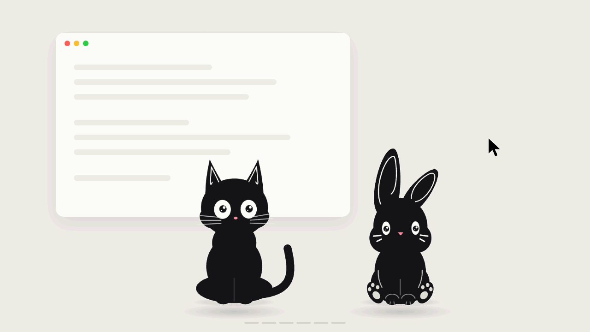

# Ember

**A desktop pet for macOS and Windows.** Imp the black cat and Sparky the bunny live on top of
your windows: they stroll around, follow the cursor, react to clicks, listen to music with you,
fall asleep when you step away, and now and then say something in a speech bubble — a joke, a fun
fact, a bit of encouragement or a reminder to stretch. They never get in the way: the pet never
steals focus, and clicks pass through its transparent areas.



The interface and the phrases are available in English, Russian and Chinese.

## Download and install

### 1. Download the installer

1. Open the **[latest release](https://github.com/artemartidag-ux/ember/releases/latest)**.
2. Scroll down to **Assets** and click the file for your computer — the download starts right away:

| Your computer | File to download |
| --- | --- |
| Mac with Apple silicon (M1, M2, M3, M4) | `Ember-0.1.0-mac-arm64.dmg` |
| Mac with an Intel processor | `Ember-0.1.0-mac-x64.dmg` |
| Windows 10 or 11 | `Ember-0.1.0-win-x64-setup.exe` |

Not sure which Mac you have? Click the Apple menu (top left) → **About This Mac**. If it says
"Chip: Apple M…", take `mac-arm64`; if it says "Processor: Intel", take `mac-x64`.

**Don't use the green "Code" button or "Source code (zip)".** They download the source code for
developers — there is no app inside. The app is only in the `.dmg` and `.exe` files under **Assets**.

### 2. Install on a Mac

1. Open your **Downloads** folder and double-click `Ember-0.1.0-mac-arm64.dmg`
   (or `…-mac-x64.dmg`). In Safari you can also click the download arrow at the top right.
2. In the window that opens, drag the **Ember** icon onto the **Applications** folder.
3. Open the **Applications** folder and double-click **Ember**.
4. The first time, macOS says it can't verify the developer — Ember isn't signed with a paid
   Apple certificate. Allow it once:
   - **macOS 15 (Sequoia) and later:** click **Done**, then open **System Settings → Privacy &
     Security**, scroll down to "Ember was blocked to protect your Mac" and click **Open Anyway**,
     then confirm with your password.
   - **macOS 14 (Sonoma) and earlier:** **right-click** Ember in Applications → **Open** →
     click **Open** again.
5. Done: the pet appears at the bottom of the screen. Its icon is in the menu bar at the top right —
   settings and **Quit** are there. There is no Dock icon.

If macOS says Ember is "damaged and can't be opened", open the **Terminal** app, paste this line,
press Return, and open Ember again:

```bash
xattr -dr com.apple.quarantine /Applications/Ember.app
```

### 3. Install on Windows

1. Open the downloaded `Ember-0.1.0-win-x64-setup.exe` (it's in your **Downloads** folder).
2. Windows shows a blue window **"Windows protected your PC"** — the installer isn't signed with a
   paid certificate. Click **More info**, then **Run anyway**.
3. Follow the installer: **Next → Install → Finish**.
4. Done: the pet appears on the desktop. Its icon is in the tray next to the clock — settings and
   **Quit** are there. Ember is also in the Start menu.

The Windows version is tested less than the Mac one. If something doesn't work, please open an
[issue](https://github.com/artemartidag-ux/ember/issues).

## What Ember knows about you — nothing

- **No internet access.** The app has no network code, analytics, ads, auto-updates or accounts,
  and its pages are forbidden from making any network requests.
- **Collects and sends nothing.** No telemetry, no crash reports.
- **Doesn't read your screen, keyboard or files.** Ember knows you're around from the system idle time, not from keystrokes.
  "Music is playing" comes from the system's audio activity flag, without access to the audio itself.
- **Asks for no permissions** — no camera, microphone, file access or Accessibility.
- The only things stored on your computer are your settings:
  `~/Library/Application Support/Ember/` on macOS, `%APPDATA%\Ember\` on Windows.
  Delete that folder and nothing is left behind.

The code is open, so you can check all of this yourself.

## Uninstall

- **macOS:** choose **Quit** in Ember's menu, then drag Ember from Applications to the Trash.
  Settings are in `~/Library/Application Support/Ember/`.
- **Windows:** **Settings → Apps → Ember → Uninstall**.

## License

- **Code** — [MIT](LICENSE): read it, change it, use it in your own projects.
- **The characters Imp and Sparky** — **all rights reserved** ([LICENSE-CHARACTERS.md](LICENSE-CHARACTERS.md)).
  They may be used only as part of Ember and when writing about it; any other use — other
  projects, merchandise, AI training — requires the author's written permission.
- Third-party notices — [THIRD_PARTY_NOTICES.md](THIRD_PARTY_NOTICES.md).

---

## For developers

Stack: Electron 44, React 19, TypeScript, electron-vite, electron-builder, vitest.
Requires Node.js ≥ 22.18 (24 LTS recommended).

```bash
npm install
npm run dev
```

If npm 11+ warns about blocked install scripts, they are already allowed in
`package.json → allowScripts` (esbuild, electron-winstaller). Electron downloads its binary on first run.

| Command | What it does |
| --- | --- |
| `npm run dev` | development mode with HMR |
| `npm start` | run the production build (`electron-vite preview`) |
| `npm run typecheck` | type-check main/preload and renderer |
| `npm test` | unit and integration tests (vitest) |
| `npm run build` | typecheck + build into `out/` |
| `npm run dist` | installer for the current OS in `release/<version>/` |
| `npm run dist:mac` | DMG for arm64 and x64, ad-hoc signed (no certificate) |
| `npm run dist:mac:signed` | DMG signed with a Developer ID (see "Signing" below) |
| `npm run dist:win` | NSIS installer for Windows x64 |
| `npm run generate:characters` | redraw the built-in characters (SVG) |
| `npm run generate:assets` | redraw the tray and app icons |

### Characters

- **Imp** — a black cat drawn by code every frame
  ([src/renderer/common/rigs/blackCat.ts](src/renderer/common/rigs/blackCat.ts)). Poses blend into
  each other like in a cartoon: he follows the cursor with his head and pupils, perks up at fast
  cursor movement, sits down after a walk, flicks his ears and tail, blinks. With music he puts on
  headphones and nods to the beat; a click makes him jump, four quick clicks make him dizzy; he
  dangles by the scruff when dragged and sleeps curled up with "z"s.
- **Sparky** — a bunny in the same style ([src/renderer/common/rigs/bunny.ts](src/renderer/common/rigs/bunny.ts)):
  long ears, a pompom tail, moves by hopping.

Nine emotions ([src/shared/expressions.ts](src/shared/expressions.ts)):

| | 1 | 2 | 3 |
| --- | --- | --- | --- |
| row 1 | blinks (every 2.5–6 s) | laughs (click) | in love (click) |
| row 2 | surprised (being dragged) | talks (while a phrase is shown) | listens to music |
| row 3 | sleeps (you stepped away) | yawns (before sleep, break reminder) | dizzy (4 quick clicks) |

### Controls

- **Drag** — hold the left mouse button on the pet and move.
- **Click** — a reaction; 4 quick clicks — "dizzy".
- **Right-click** — menu: settings, hide, pause, walks, bring back on screen, quit.
- **Tray / menu bar** — the same menu. On Windows, left-clicking the icon opens settings.
- Closing the settings window doesn't quit the app; **Quit** ends all processes.
- Launching a second time opens the settings of the running instance instead of a second pet.

Settings: character (Imp or Sparky), size, opacity (min 25%), speed, walks, pause,
cursor following, smooth animation, click-through, always on top, bubble style, how the pet
addresses you, launch at login, display, show / hide / bring back.

### Phrases

The speech bubble is a separate transparent window that clicks pass through. All phrases are
statements, never questions: the pet entertains but never demands an answer (covered by a test).
Texts are in [src/shared/phrases.ts](src/shared/phrases.ts).

| When | What |
| --- | --- |
| launch | a greeting for the time of day |
| randomly while you're at the computer | jokes, facts, encouragement; day-of-week lines; late at night — about sleep |
| ~50 minutes of work without a break, then every 40 | stretch, water, rest your eyes |
| back after 5+ minutes away | "welcome back" |
| click (sometimes), 4 quick clicks, drag (sometimes) | a short reaction |

Phrases rotate: within a category a phrase won't repeat until all others have been shown.
Presence is detected from system idle time (`powerMonitor.getSystemIdleTime`, polled every
30 seconds) — no keyboard or screen access.

### Security

- `contextIsolation: true`, `nodeIntegration: false`, `sandbox: true`; `webSecurity` is never disabled.
- The renderer gets only a narrow typed API ([src/preload/index.ts](src/preload/index.ts)); main
  checks the sender of every IPC message (webContents and main frame) and validates the arguments.
- No file system, shell or command access from the renderer; file dialogs are opened by main.
- No remote pages; navigation, new windows, `<webview>` and permission requests are denied.
- Content Security Policy in production: `script-src 'self'`, `connect-src 'none'`.
- Character images are served through a custom `pet-asset://` protocol — only images from the
  character's own folder inside the app.

### Platform notes

- **Click-through.** The pet window ignores the mouse by default
  (`setIgnoreMouseEvents(true, { forward: true })`); the renderer reads the alpha of the pixel under
  the cursor and makes the window clickable only over opaque pixels. If this is unreliable on your
  system, turn off click-through in settings — the window becomes clickable as a whole.
- **Displays.** Positions use Electron `screen` coordinates (DIP), including negative ones, and are
  clamped to the work area. When a display is disconnected or its resolution changes, the pet comes
  back into view.
- **Focus.** The pet window is `focusable: false` and shown with `showInactive()`; no taskbar button
  on Windows (`skipTaskbar`).
- **macOS.** No Dock icon (`LSUIElement`); the menu bar icon is a template image that adapts to
  light and dark mode.
- "Always on top" uses the *floating* level: above regular windows, but not above full-screen apps.
- Linux is not supported (click-through works differently there).

### Signing

Without certificates the builds work, but the OS warns on first launch (see "Download and install").

**macOS (Developer ID + notarization)** requires the paid Apple Developer Program. Set
`CSC_LINK` (.p12 "Developer ID Application" certificate), `CSC_KEY_PASSWORD`, `APPLE_ID`,
`APPLE_APP_SPECIFIC_PASSWORD`, `APPLE_TEAM_ID` and run `npm run dist:mac:signed`. Hardened runtime and
entitlements are already configured (`build/entitlements.mac.plist`).

**Windows** requires a code signing certificate (OV/EV) or Azure Trusted Signing. For a .pfx set
`CSC_LINK` (or `WIN_CSC_LINK`) and `CSC_KEY_PASSWORD`, then run `npm run dist:win`.

### Project structure

```
src/shared/     pure logic: types, character.json schema, frames, state machine, geometry, gaze
src/main/       windows, tray, IPC, pet-asset:// protocol, character library, settings
src/preload/    contextBridge API
src/renderer/   pet (canvas) and settings (React)
resources/      built-in characters and tray icons
scripts/        icon and built-in character generators
tests/          vitest
docs/           demo animation
```
